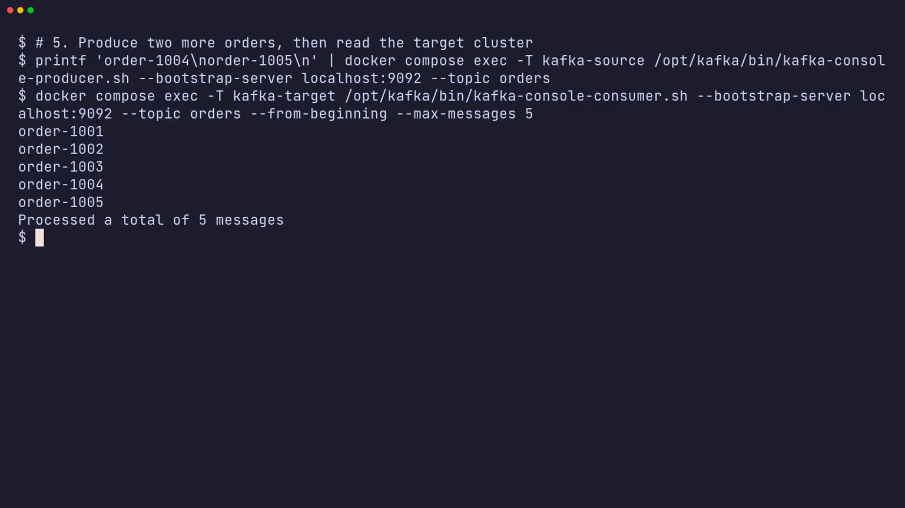

# kaf-mirror

[](https://github.com/scalytics/kaf-mirror/actions/workflows/ci.yml)
[](https://github.com/scalytics/kaf-mirror/releases)
[](LICENSE)

**Mirror Kafka topics between any two Kafka clusters.**

Apache Kafka, Confluent, Redpanda and Azure Event Hubs work as source or target, with a dashboard, audit trail and compliance reports. kaf-mirror is a MirrorMaker alternative for Kafka replication that you can operate from a web UI or a CLI. Apache 2.0. Docs and demo: [kafmirror.scalytics.io](https://kafmirror.scalytics.io/).

[](https://kafmirror.scalytics.io/)

*Two Kafka clusters, one kaf-mirror, about two minutes. Click the picture to watch.*

## Quick start

You need Docker with Compose and Go. Or download `mirror-cli` from the [releases](https://github.com/scalytics/kaf-mirror/releases) (Linux amd64/arm64, macOS Intel/Apple Silicon, or Windows amd64) and skip the `go build` line. Run these from a clone of this repository. `docker compose` builds the image on the first run and starts two Redpanda brokers and kaf-mirror.

```bash
git clone https://github.com/scalytics/kaf-mirror.git && cd kaf-mirror
go build -o bin/mirror-cli ./cmd/mirror-cli && export PATH="$PWD/bin:$PATH"
docker compose -p kaf-mirror up -d
```

Read the generated admin password, delete the file, and log in. `login` asks for the password and masks it.

```bash
docker compose -p kaf-mirror exec kaf-mirror sh -c 'cat /app/data/kaf-mirror-bootstrap-*'
docker compose -p kaf-mirror exec kaf-mirror sh -c 'rm /app/data/kaf-mirror-bootstrap-*'
mirror-cli login admin@localhost
```

Add the two clusters with `mirror-cli clusters add`. The command is interactive and takes no arguments. Run it twice and answer the prompts as follows.

| Prompt | First run | Second run |
| --- | --- | --- |
| Cluster name: | `source` | `target` |
| Select provider: | `plain` | `plain` |
| Brokers (comma-separated): | `kafka-source:9092` | `kafka-target:9092` |
| Cluster role: | `other` (the default) | `other` (the default) |
| Would you like to list the topics in the new cluster? | no | no |

```bash
mirror-cli clusters add
mirror-cli clusters add
```

Produce three orders, then create a job for the `orders` topic and start it. `jobs add` is interactive and takes no arguments. Answer the prompts as follows, and keep the defaults for batch size (1000), compression (`none`), the custom target name (no) and the final confirm (yes). `jobs start` with no id asks you to pick the job. Select `orders-copy`.

| Prompt | Answer |
| --- | --- |
| Enter job name: | `orders-copy` |
| Select source cluster: | `source` |
| Select target cluster: | `target` |
| Select topics to replicate: | `orders` |

```bash
printf 'order-1001\norder-1002\norder-1003\n' | docker compose -p kaf-mirror exec -T kafka-source rpk topic produce orders --allow-auto-topic-creation
mirror-cli jobs add
mirror-cli jobs start
```

Produce two more orders, read all five from the target, and check the job status and lag. `jobs status metrics` with no id also asks you to pick the job. Select `orders-copy` again.

```bash
printf 'order-1004\norder-1005\n' | docker compose -p kaf-mirror exec -T kafka-source rpk topic produce orders
docker compose -p kaf-mirror exec -T kafka-target rpk topic consume orders --offset start --num 5
mirror-cli jobs status metrics
```

The UI is at http://localhost:8080. Stop everything and delete its data with `docker compose -p kaf-mirror down -v`.

To run a published image instead of building one:

```bash
docker run -d --name kaf-mirror -p 8080:8080 \
  -v kaf-mirror-data:/app/data -v kaf-mirror-logs:/app/logs \
  ghcr.io/scalytics/kaf-mirror:v2.0.0
```

More ways to run it, including bind mounts, a systemd service and Helm, are in [docs/getting-started.md](docs/getting-started.md).

## What it does

- **Jobs:** built with franz-go. Same-name mirroring is the default, with exact and regex topic mappings. [Topic mappings](docs/topic-mappings.md)
- **Offsets after ack:** source offsets are committed only after the target acknowledges the write. [Resilience](docs/resilience.md)
- **Web UI:** operations, health, executive and compliance tabs. [Features](docs/features.md)
- **Roles:** admin, operator, monitoring and compliance, with token authentication. [RBAC](docs/rbac.md)
- **Metrics and lag:** counters and lag for every job, over the API and in the CLI. [Job metrics](docs/metrics.md)
- **Compliance:** scheduled compliance reports and an audit trail of every change. [Administration](docs/administration.md)
- **Kafka security:** TLS, mTLS, SASL and Kerberos to the brokers. [Security](docs/security.md)
- **AI insights:** opt-in and off by default. Without a provider kaf-mirror makes no AI requests. [Configuration](docs/configuration.md#ai-analysis)
- **Replication halt (tech preview):** off by default and admin-only. Freezes replication if the source is compromised, for example by ransomware. [Replication halt](docs/protection.md)

## Need a backup, not just a replica?

A replica copies deletes and bad writes too, and so does anything done with stolen producer credentials. For a Kafka backup, mirror into a target that your producers cannot touch, on separate credentials. [KafScale](https://kafscale.io) is one option: a Kafka-compatible broker that keeps immutable segments in S3. Any Kafka-compatible target works the same way. The steps are in [docs/kafscale-backup.md](docs/kafscale-backup.md).

## Use cases

- **Hot standby and backup.** Use kaf-mirror between two Kafka clusters for a hot standby. For a backup that a bad delete does not reach, mirror into a separate target such as KafScale on S3. See [Kafka backup vs replication](https://www.scalytics.io/kafka-backup-vs-replication).
- **DORA and NIS2.** The audit trail and scheduled compliance reports help show how the copy is run and checked. See the [Kafka DORA and NIS2 checklist](https://www.scalytics.io/kafka-dora-nis2-checklist).
- **Migration and failover drills** between Kafka-protocol clusters, with same-name, exact or regex topic mapping.

## Documentation

| Topic | Page |
| --- | --- |
| Run it locally, from an image or from binaries | [getting-started.md](docs/getting-started.md) |
| Kubernetes and Helm | [kubernetes.md](docs/kubernetes.md) |
| Run as a Linux service | [run-as-a-service.md](docs/run-as-a-service.md) |
| Every config key and environment variable | [configuration.md](docs/configuration.md) |
| Manage clusters, jobs, users, backups | [administration.md](docs/administration.md) |
| CLI reference and shell completion | [cli-commands.md](docs/cli-commands.md), [shell-completion.md](docs/shell-completion.md) |
| Roles and permissions | [rbac.md](docs/rbac.md) |
| Auth, TLS, mTLS and Kerberos | [security.md](docs/security.md) |
| Topic mappings | [topic-mappings.md](docs/topic-mappings.md) |
| What a copied record keeps | [record-fidelity.md](docs/record-fidelity.md) |
| Job metrics | [metrics.md](docs/metrics.md) |
| Resilience and buffering | [resilience.md](docs/resilience.md) |
| Replication halt (experimental) | [protection.md](docs/protection.md) |
| Back up to S3 with KafScale | [kafscale-backup.md](docs/kafscale-backup.md) |
| Architecture | [architecture.md](docs/architecture.md) |
| API (Swagger at `/docu/swagger/` when running) | [api.md](docs/api.md) |
| Testing | [testing.md](docs/testing.md) |

The full index is [docs/README.md](docs/README.md).

## Managed or supported

kaf-mirror is part of [Lascaris](https://www.scalytics.io/lascaris). Scalytics can run it for you in your own cloud, or support your team running it on-prem or air-gapped. More open source from the same team, including [kshark-core](https://github.com/scalytics/kshark-core) for Kafka connectivity checks, is listed at [scalytics.io/open-source](https://www.scalytics.io/open-source).

## Contributing

See [CONTRIBUTING.md](CONTRIBUTING.md).

## License

Apache License 2.0. See [LICENSE](LICENSE).
